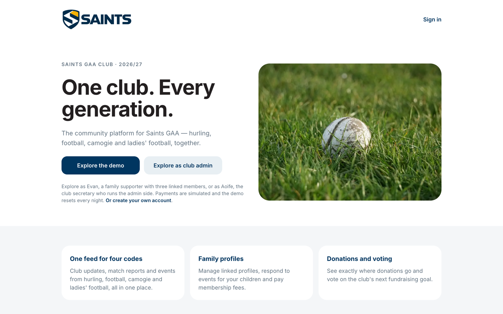
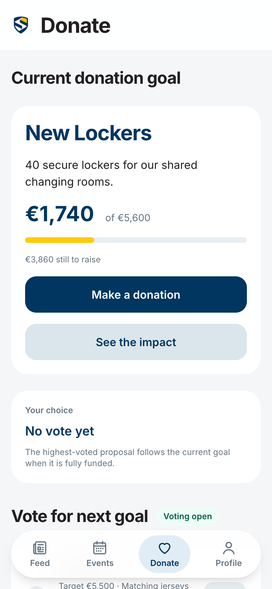
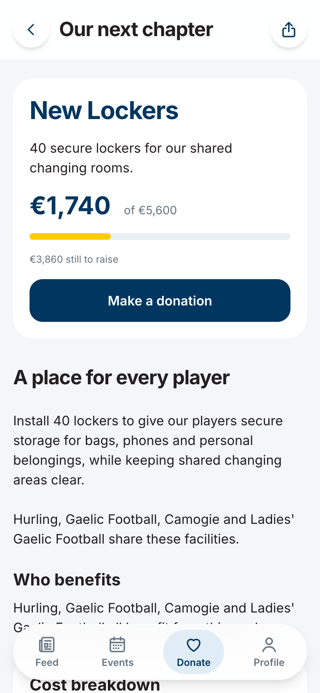
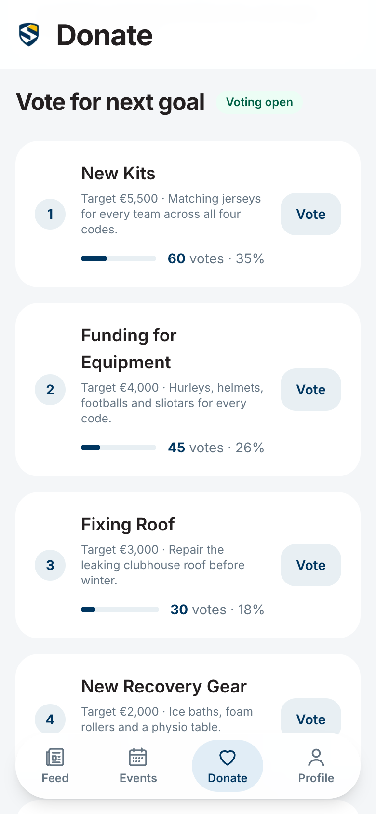
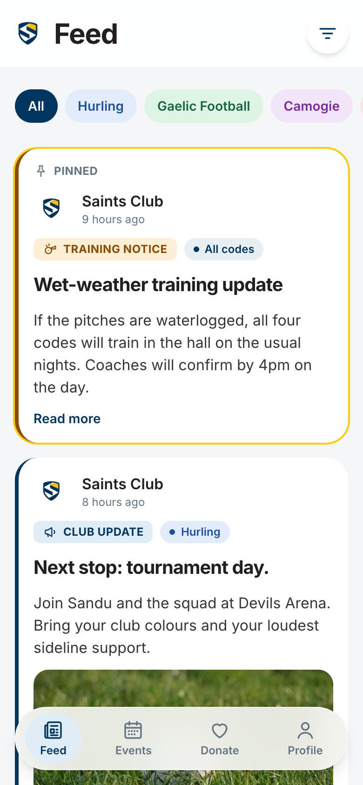
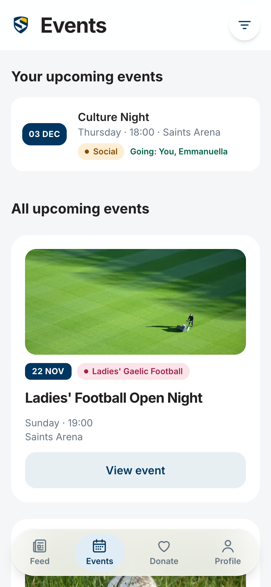
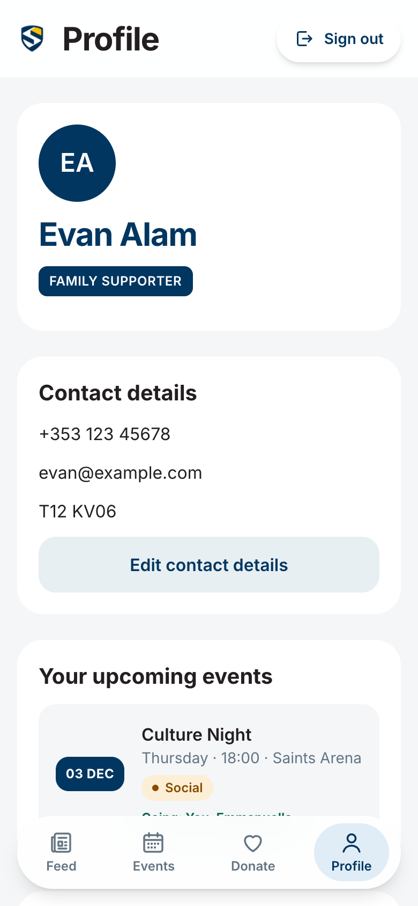
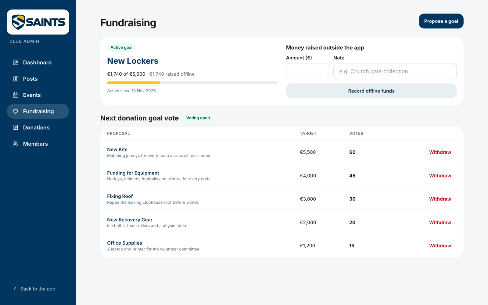

# GAA Community Platform

**One club. Every generation.** This is a free, open-source community platform for GAA clubs. Players and families across hurling, football, camogie and ladies' football can follow club news, respond to events, pay membership and fund shared goals that they choose together. Club officers run all of it from one admin area.

The demo is set up as **Saints**, a fictional multi-code club. Changing one config file turns it into your club.



> **Try the demo:** go to **[saintsgaa.social](https://saintsgaa.social)** and pick one of two options:
>
> - **Explore the demo** signs you in as Evan, a family supporter who manages three linked family members.
> - **Explore as club admin** lets you run the club as Aoife, the club secretary.
>
> Payments are simulated, so no money is ever taken. Everything resets every night, so feel free to click around.
>
> If the main domain doesn't load, use the Vercel fallback: **[saints-community-platform.vercel.app](https://saints-community-platform.vercel.app)**.

## Why it exists

Fundraising in a GAA club often happens through a bucket at the gate, a raffle, or a link to a generic crowdfunding page. Members rarely see where the money goes or get any say in what it's for, and in a club with several codes it can feel like the money only ever helps one of them.

So the first version of the platform does two things:

1. **Transparent donations.** The club has one active fundraising goal at a time, such as new lockers or pitch lighting. The goal comes with a plain cost breakdown, a list of who benefits across all four codes, and live progress toward its target.
2. **Member-led priorities.** Members vote on which proposed goal comes next, one member one vote. When the current goal is fully funded, the top-voted goal becomes active automatically. If the vote is tied, a club officer makes the final choice and the decision is logged.

<p align="center">
  
  &nbsp;
  
  &nbsp;
  
</p>

Everything else in the app (the feed, events, RSVPs, family profiles and membership fees) exists so that members have a reason to open it every week, not only when the club is asking for money.

## Features

### For members

| | Feature |
| --- | --- |
| 💛 | **Donate** to the club's active goal, with a transparent cost breakdown and a receipt for every donation |
| 🗳️ | **Vote** for the next goal. When the current one is funded, the top-voted goal takes its place |
| 📰 | **Feed** with club updates from all four codes, filterable by code, plus posts pinned by admins |
| 📅 | **Events**: a calendar you can filter by code, event details and schedules, reminders, share links and `.ics` export |
| ✅ | **RSVP** for yourself or any family member you manage, with capacity and deadline checks |
| 💳 | **Membership fees** per playing member per season (payments are simulated in the demo) |
| 👪 | **Family profiles**: add, edit and remove linked family members. Adult family members can take over their own profile |
| 🔐 | **Account**: change or reset your password, or delete your account (GDPR) |

<p align="center">
  
  &nbsp;
  
  &nbsp;
  
</p>

### For club officers (`/admin`)

| | Feature |
| --- | --- |
| 📊 | **Dashboard** showing accounts, membership collected and outstanding, donations and the current goal, plus an **activity log** of every admin change |
| 💛 | **Fundraising**: propose goals with a cost breakdown, withdraw or restore them, record money raised offline, and break tied votes |
| 📰 | **Posts**: publish, pin, edit and delete feed updates, with photos and call-to-action buttons |
| 📅 | **Events**: create, edit, cancel and delete events. Families who said "going" are emailed when an event is cancelled. See who's coming and export the list to CSV |
| 👥 | **Members**: search accounts, grant admin access, edit roles and family members, and record cash or sponsored memberships |
| 🧾 | **Donations**: the full ledger, with filters and CSV export |



Admins are ordinary accounts with an admin flag, so there's no separate login. A daily job sends event reminders and resets the public demo.

## Use it for your club

The code is under the [MIT license](LICENSE). Any club, developer or organisation can use it, change it and run it for free, including commercially. You don't need to ask us first, but we'd love to hear about it.

### Run it locally

You need **Node.js 20+** and **pnpm** (`npm i -g pnpm`). You don't need Docker or any cloud accounts.

```bash
git clone https://github.com/meetdanielme/gaa-community-platform.git
cd gaa-community-platform
pnpm install
pnpm dev
```

Open <http://localhost:3000> and click **Explore the demo** or **Explore as club admin**. You can also sign in as `evan@example.com` or `admin@example.com` with the password `saints-demo-2026`. Emails such as password resets and reminders are printed in the terminal.

`pnpm dev` starts a local Postgres database (embedded [PGlite](https://pglite.dev), stored in `.data/`), applies migrations, seeds the demo data on the first run and starts Next.js.

### Make it your club's

1. Edit **[`src/club.config.ts`](src/club.config.ts)**: name, tagline, season, brand colours, logo, codes, membership fee and donation presets. Swap the files in `public/brand/` and the icons in `src/app/` for your club's own.
2. Set `DEMO_MODE=false`, which removes the sample content, the demo buttons and the nightly reset. Set `ADMIN_EMAILS=you@yourclub.ie` as well.
3. Sign up with that email address. That account becomes the club's first admin. From **/admin** you can create events, posts and fundraising goals, and give admin access to other officers under **Members**.
4. For email (password resets, reminders and cancellation notices), add `RESEND_API_KEY` and `EMAIL_FROM` from [Resend](https://resend.com).

The Saints sample content lives in [`src/server/demo-data.ts`](src/server/demo-data.ts).

### Deploy to Vercel

1. Import your fork into [Vercel](https://vercel.com/new).
2. Add a Postgres database under **Storage → Create → Neon**. This sets `DATABASE_URL` for you.
3. Add `BETTER_AUTH_SECRET` (generate one with `openssl rand -base64 32`) and `CRON_SECRET` (any long random string; it protects the daily job).
4. Deploy. The build runs the migrations, and in demo mode it seeds the demo data if the database is empty.

Every setting, including email and custom domains, is documented in [`.env.example`](.env.example). Any host that runs Next.js and can reach a Postgres database will work too.

> Preview deployments share the production database unless you turn on Neon's preview-branch integration. Turn it on before you accept pull requests that change the schema.

### Useful scripts

| Command | What it does |
| --- | --- |
| `pnpm dev` | Starts the local database, runs migrations and seeding, and starts the Next.js dev server |
| `pnpm test` | Business-rule unit tests and service integration tests (in-memory Postgres) |
| `pnpm typecheck` / `pnpm lint` | TypeScript and ESLint |
| `pnpm db:reset` | Wipes and reseeds the database (needs `pnpm dev` or `pnpm db:server` running) |
| `pnpm db:generate` | Creates a migration after you edit `src/db/schema.ts` |
| `pnpm db:server` | Runs only the local database, for example for `pnpm db:studio` |

## How it's built

- **[Next.js 16](https://nextjs.org)** (App Router, Server Components, Server Actions) and **TypeScript**
- **[Tailwind CSS 4](https://tailwindcss.com)**
- **Postgres** with **[Drizzle ORM](https://orm.drizzle.team)**: PGlite locally, any Postgres in production ([Neon](https://neon.tech) on Vercel)
- **[Better Auth](https://better-auth.com)** for email and password accounts and sessions
- **[Vitest](https://vitest.dev)** for tests

```
src/
  club.config.ts        ← white-label settings: name, colours, codes, fees
  app/
    page.tsx            ← public landing page
    (auth)/             ← sign in, sign up, password reset
    (app)/              ← signed-in area: feed, events, donate, profile
      */actions.ts      ← Server Actions: validate input, call a service
    admin/              ← club officer area
  server/               ← services: database reads/writes + transactions
  lib/rules/            ← pure business rules + unit tests
  db/schema.ts          ← database tables
  components/           ← shared UI
scripts/                ← dev database, migrations, seed data
drizzle/                ← SQL migrations
docs/                   ← design diagrams, brand kit, design-to-code notes
```

Every feature follows the same path: **page → action → service → rule**. Pages render the UI. Actions check the signed-in user and validate input with Zod. Services talk to the database inside transactions. Rules make the decisions, such as who can vote, whether an event is full and when the next goal becomes active. Rules are pure functions with no database access, which makes them easy to read and test.

The Saints brand kit (logo, colours and usage rules) is in [`docs/brand`](docs/brand).

## Contributing

The platform is open source because GAA clubs are run by volunteers. Most clubs can't pay for custom software, and they shouldn't each have to build the same thing from scratch. If one club or student builds a feature, every club can use it.

Anyone is welcome to contribute: students, developers, club officers and anyone who loves the GAA. You don't have to write code either. Bug reports, feature ideas from real club life, design feedback, translations and accessibility testing all help.

Here's how it works:

1. **Open an issue** to report a bug or suggest a feature. Start from the club need: "parents can't see which training sessions moved" is more useful than "add a calendar widget".
2. **Fork the repo** and make your change on a branch. Issues labelled `good first issue` are a good place to start.
3. **Open a pull request.** CI runs lint, type checks and tests, and a maintainer reviews it.

The full guide is in [CONTRIBUTING.md](CONTRIBUTING.md).

## Background

The platform started as our team's submission for **IS2204: Visual Thinking for Systems Analysis & Design**, a module in the **Business Information Systems** degree at **University College Cork**.

The module gave us a hypothetical case. Saints is a newly formed club that brings hurling, Gaelic football, camogie and ladies' football together under one roof. The brief asked how a digital system could help the club grow as an inclusive, equitable and sustainable community, not just win matches. The ideas that shaped our design were these:

- **One club, four equal codes.** No code should feel like an afterthought, and differences in access and investment between codes should be visible.
- **The family is the core unit.** Participation depends on parents, guardians, siblings and supporters as much as on the player.
- **Value means more than results.** Belonging, wellbeing, volunteer sustainability and transparent governance count too.
- **Ethics is part of the design.** Consent, data minimisation and careful handling of children's data were requirements from the start.

Over five two-week design sprints, we narrowed the scope from a broad club-management idea to a focused end-user platform with donations and voting at its centre. Each sprint produced a set of artefacts that the next one built on:

1. **Use-case model and wireframes**: who uses the system and what they need from it
2. **Activity diagrams and business rules**: the donation and voting workflows, including edge cases such as ties and failed payments
3. **Interactive lo-fi and hi-fi prototypes** in Figma, with a decision table for who may vote
4. **Data flow diagrams** tracing how donation and vote data moves through the system
5. **Entity relationship diagrams**, alongside this working prototype

The live app implements that design. The business rules from the sprints became the tested functions in `src/lib/rules`. [docs/coursework-traceability.md](docs/coursework-traceability.md) maps each use case to its screens, rules and tests, and the diagrams are in [`docs/design`](docs/design).

### Building it with AI

We used AI throughout the project, and we checked its output against our own models and our lecturer's feedback rather than accepting it as it came.

- **Design.** We drew the use cases, workflows and rules ourselves, by hand and in Lucid, and argued them out as a team. We then used OpenAI Codex to help build and refine the Figma prototypes, draft sample content and draft data flow diagrams. We revised all of it after feedback on layout, colours and readability.
- **Code.** We built the working app with Claude Code, an AI coding agent. We used the sprint artefacts as the specification: the use-case descriptions, activity diagrams, business rules and hi-fi screens. The agent wrote the code in small, reviewable steps, and the commit history shows the AI co-authorship. We reviewed each change, tested it in the browser and fed demo feedback into the next round of changes.
- **Guardrails.** The rules are pure functions with unit tests, so we could check that the code makes the same decisions as our diagrams. The same tests now protect the project for anyone who contributes.

Our main lesson: AI made it realistic for a student team to go from diagrams to a deployed app in a few days. But it was only as good as the specification we gave it, and the clearer our models were, the better the code it wrote.

## Credits

Designed and built by IS2204 Group 16, University College Cork (2026):

| Team member | LinkedIn | GitHub |
| --- | --- | --- |
| Evan Alam | [Evan Alam](https://ie.linkedin.com/in/evan-alam-565b33384) | [@evaexia](https://github.com/evaexia) |
| Idayat Majolagbe | [Idayat Majolagbe](https://www.linkedin.com/in/idayat-majolagbe-9935a7354/) | — |
| Daniel Marcinkowski | [Daniel Marcinkowski](https://ie.linkedin.com/in/meetdanielme) | [@meetdanielme](https://github.com/meetdanielme) |
| Chloe Mitellus | [Chloé Mitellus](https://ie.linkedin.com/in/chlo%C3%A9-mitellus-504072386) | [@iv0-0vi](https://github.com/iv0-0vi) |
| Emma Ntumobe | [Emmanuella Ntumobe](https://ie.linkedin.com/in/emmanuella-ntumobe-52b797384) | — |
| Sandu Stati Suman | [Sandu Stati Suman](https://ie.linkedin.com/in/sandu-stati-suman-595b30384) | [@courius](https://github.com/courius) |

Thanks to Prof. David Sammon and the Department of Business Information Systems at UCC for the case and the feedback along the way.

Photography by Adrian Payne (sliotar), Rémi Müller (pitch maintenance) and enrico bet (Croke Park) on [Unsplash](https://unsplash.com/license). Saints is a fictional club, and any costs shown are illustrative.

## License

[MIT](LICENSE): free to use, modify and distribute.
