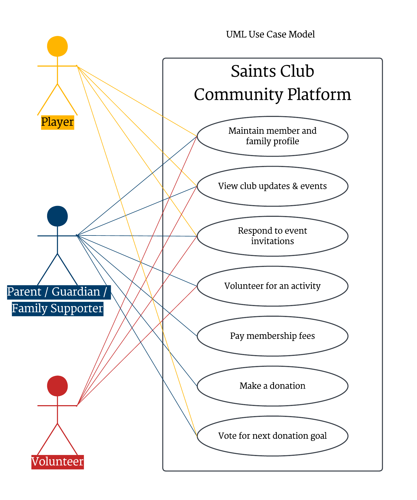

# From coursework to code

This platform implements the design produced by IS2204 Group 16 across Sprints 1–4: the use-case model, activity diagrams (D01–D07), structured business rules (BR01–BR08) and the Figma hi-fi prototype. This page shows where each part ended up, so the design and the code can keep evolving together.

## Actors

| Actor | Role id in code | May… |
| --- | --- | --- |
| Player | `player` | maintain profile, view, respond, **vote** |
| Parent / Guardian / Family Supporter | `family_supporter` | everything above, plus **volunteer, pay fees, donate** |
| Volunteer | `volunteer` | maintain profile, view, respond, **volunteer** |

A person may hold several roles (chosen at sign-up, editable in Profile). An unconnected role alone does not grant access — see `src/lib/rules/roles.ts`.

## Use cases → screens → rules → tests

| Use case | Activity diagram | Business rule | Screens | Rule code | Tests |
| --- | --- | --- | --- | --- | --- |
| UC1 Maintain member and family profile | [D01](design/d01-maintain-member-and-family-profile.png) | BR01 Profile permission | `/profile`, `/profile/members/*` | `getManagedMember`, `saveMember` in `src/server/profile.ts`; Zod validation in `profile/actions.ts` | integration: "hides other families' members", "never changes the account holder's own profile" |
| UC2 View club updates and events | [D02](design/d02-view-club-updates-and-events.png) | BR02 Content access | `/feed`, `/events` | `src/server/feed.ts`, `listEvents` | — |
| UC3 Respond to event invitations | [D03](design/d03-respond-to-event-invitations.png) | BR03 Event response | `/events/[slug]` → *Respond* sheet | `decideEventResponse` in `src/lib/rules/events.ts` | unit: full event, keep existing place, release place, deadline; integration: respond for linked member only |
| UC4 Volunteer for an activity | [D04](design/d04-volunteer-for-an-activity.png) | BR04 Volunteer registration | `/events/[slug]` → *Lend a hand* | `decideVolunteer` | unit + integration: same-day conflict warning then acknowledgement |
| UC5 Pay membership fees | [D05](design/d05-pay-membership-fees.png) | BR05 Fee payment | `/profile/members/[id]` → *Pay membership* | `decideFeePayment` in `src/lib/rules/payments.ts` | unit: never re-charge a pending fee; integration: declined then paid then "already paid" |
| UC6 Make a donation | [D06](design/d06-make-a-donation.png) | BR06 Donation payment | `/donate` → amount → review → result sheets | `validateDonation`; `makeDonation` in `src/server/fundraising.ts` | integration: declined card records nothing; retry with same key is idempotent |
| ↳ Advance donation goal | [D06A](design/d06a-advance-donation-goal.png) | BR08 Goal progression | `/donate/achieved` | `decideProgression` in `src/lib/rules/progression.ts`; `advanceIfFunded` | unit: €1,740 retains, 45/30/60/20/15 → New Kits, tie → pending; integration: full campaign to New Kits |
| UC7 Vote for next donation goal | [D07](design/d07-vote-for-next-donation-goal.png) | BR07 Voting | `/donate` → *Vote for this goal* sheet | `decideVote` in `src/lib/rules/voting.ts`; `castVote` | unit + integration: save, repeat = unchanged, change = replace, closed round, ineligible voter |

## Working assumptions carried into code

These were listed as "to confirm with the group" in the Sprint 2 rules pack. The code implements them as stated; change the rule function and its test if the group decides otherwise.

1. **One current vote per person per round** — enforced by the `vote` table's primary key `(round_id, user_id)`.
2. **People cast their own vote** — managing a family member does not let you vote for them.
3. **Voting doesn't depend on donating.**
4. **The round closes when the current target is reached**; votes don't carry into the next round.
5. **Ties, no candidates or zero votes → "selection pending"**; the platform never picks arbitrarily. (Resolving it needs the club admin area on the roadmap.)
6. **Progression happens once per campaign** — the active goal row is locked (`SELECT … FOR UPDATE`) so concurrent donations can't activate two goals.
7. **Full events reject new "Going" responses**; re-confirming an existing place is allowed; there's no waiting list. Volunteering conflicts warn and continue after acknowledgement.
8. **Registration and publishing content are prerequisites** — sign-up exists; publishing is seed data for now.

## Differences from the prototype

- The RSVP sheet lists every family member you manage instead of one "Respond for Sandu" button, so a parent can answer for the whole family at once.
- *Change payment method* offers two demo cards: `···· 4242` always succeeds, `···· 0002` is always declined, so the failure paths in D05/D06 can be demonstrated.
- Volunteer roles appear on event pages (UC4 had no hi-fi screen).
