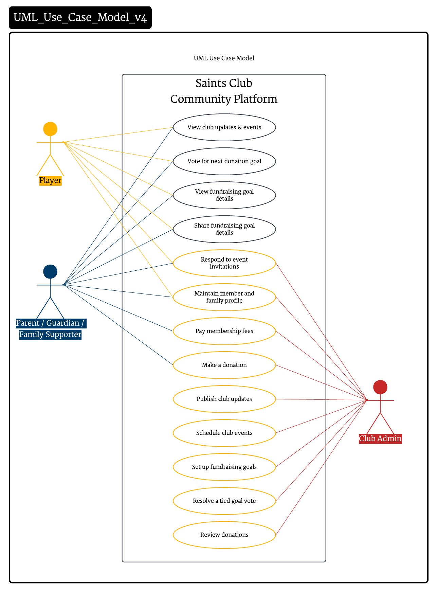

# From coursework to code

This platform implements the design produced by IS2204 Group 16 up to **Sprint 5**: the use-case model, activity diagrams, structured business rules and the Figma hi-fi prototype, with the donation and voting DFDs at its core. Sprint 5 brought the model in line with what was built. Volunteering is gone, and a Club Admin actor now shares use cases with members. This page shows where each part ended up, so the design and the code can keep evolving together.

The Sprint 5 diagrams are in [`docs/design/ca5`](design/ca5). Gold outlines mark what is new or updated in Sprint 5, the same convention as earlier sprints.

## What changed in the v4 model

- **Removed:** the Volunteer actor and *Volunteer for an activity* (UC4). They never had prototype screens and aren't built.
- **Added:** the **Club Admin** actor (staff, so it's drawn on the right) with five admin-only use cases. These are *Publish club updates*, *Schedule club events*, *Set up fundraising goals*, *Resolve a tied goal vote* and *Review donations*.
- **Shared:** a use case can have more than one actor. Club Admin now joins four member use cases where it takes part in the app:
  - *Respond to event invitations*: sees the responses.
  - *Maintain member and family profile*: corrects records and access.
  - *Pay membership fees*: records cash or sponsored fees.
  - *Make a donation*: records offline funds toward the goal.

## Actors

| Actor | How it's identified in code | May… |
| --- | --- | --- |
| Player | role `player` | maintain profile, view, respond, **vote** |
| Parent / Guardian / Family Supporter | role `family_supporter` | everything above, plus **pay fees, donate** |
| Club Admin | account flag `isAdmin`, checked by `requireAdmin()` in `src/lib/session.ts` | the `/admin` area, plus its part in the shared use cases above |

A person may hold several roles (chosen at sign-up, editable in Profile). An unconnected role alone does not grant access — see `src/lib/rules/roles.ts`. Admin is a separate flag rather than a role, so an admin can also be a player or family supporter.

## Use cases → screens → rules → tests

The *Activity diagram* column links the Sprint 5 version where one exists. The earlier D01–D07 diagrams are still in [`docs/design`](design) as history.

### Member use cases

| Use case | Activity diagram | Business rule | Screens | Rule code | Tests |
| --- | --- | --- | --- | --- | --- |
| UC1 Maintain member and family profile *(shared with Club Admin)* | [CA5](design/ca5/maintain-family-profile.png) · [D01](design/d01-maintain-member-and-family-profile.png) | BR01 Profile permission | `/profile` → *Contact details* sheet, `/profile/members/new`, `/profile/members/[id]` (edit, remove); admin `/admin/members/[id]` | `getManagedMember`, `saveMember`, `removeMember`, `updateContactDetails` in `src/server/profile.ts`; Zod validation in `src/lib/validation.ts`; `syncMembershipFee` in `src/lib/rules/membership.ts` | integration: "hides other families' members", "lets families add, edit and remove members (but never their own profile)", "only charges membership to people who play a code"; unit: membership fees |
| UC2 View club updates and events | [D02](design/d02-view-club-updates-and-events.png) | BR02 Content access | `/feed` (filter by code), `/events` | `src/server/feed.ts`, `listEvents` | — |
| UC3 Respond to event invitations *(shared with Club Admin)* | [CA5](design/ca5/respond-to-event-invitation.png) · [D03](design/d03-respond-to-event-invitations.png) | BR03 Event response | `/events/[slug]` → *Respond* sheet; admin `/admin/events/[id]` lists responses | `decideEventResponse` in `src/lib/rules/events.ts` | unit: full event, keep existing place, release place, deadline; integration: respond for linked member only, reject past events |
| UC5 Pay membership fees *(shared with Club Admin)* | [CA5](design/ca5/pay-membership-fee.png) · [D05](design/d05-pay-membership-fees.png) | BR05 Fee payment | `/profile/members/[id]` → *Pay membership*; admin `/admin/members/[id]` marks paid or sponsored | `decideFeePayment` in `src/lib/rules/payments.ts`; `setFeeStatus` in `src/server/admin/members.ts` | unit: never re-charge a pending fee; integration: declined then paid then "already paid", "records a cash membership payment" |
| UC6 Make a donation *(shared with Club Admin)* | [CA5](design/ca5/make-a-donation.png) · [D06](design/d06-make-a-donation.png) | BR06 Donation payment | `/donate` → amount → review → result sheets; admin *Record offline funds* in `/admin/goals/[id]` | `validateDonation`; `makeDonation` in `src/server/fundraising.ts`; `recordOfflineFunds` in `src/server/admin/fundraising.ts` | integration: declined card records nothing; retry with same key is idempotent; refuses an inactive goal |
| ↳ Advance donation goal | [CA5](design/ca5/make-a-donation.png) · [D06A](design/d06a-advance-donation-goal.png) | BR08 Goal progression | `/donate/achieved` | `decideProgression` in `src/lib/rules/progression.ts`; `advanceIfFunded` | unit: €1,740 retains, 45/30/60/20/15 → New Kits, tie → pending; integration: full campaign to New Kits |
| View / share fundraising goal details | — | — | `/donate/[slug]` with breakdown; share button | `getGoalBySlug` | — |
| UC7 Vote for next donation goal | [CA5](design/ca5/vote-for-next-donation-goal.png) · [D07](design/d07-vote-for-next-donation-goal.png) | BR07 Voting | `/donate` → *Vote for this goal* sheet (votes and share of the total) | `decideVote` in `src/lib/rules/voting.ts`; `castVote` | unit + integration: save, repeat = unchanged, change = replace, closed round, ineligible voter |

### Club Admin use cases

| Use case | Activity diagram | Screens | Code | Tests |
| --- | --- | --- | --- | --- |
| Publish club updates | — | `/admin/posts`, `/admin/posts/new`, `/admin/posts/[id]` | `savePostAction`, `deletePostAction`; `src/server/admin/content.ts` | — |
| Schedule club events | — | `/admin/events`, `/admin/events/new`, `/admin/events/[id]` (edit, cancel, delete) | `saveEventAction`, `setEventCancelledAction`, `deleteEventAction` | integration: "creates, cancels and deletes events" |
| Set up fundraising goals | — | `/admin/goals`, `/admin/goals/new`, `/admin/goals/[id]` | `saveGoal`, `setGoalWithdrawn` in `src/server/admin/fundraising.ts` | integration: "proposes, edits and withdraws goals" |
| Resolve a tied goal vote | [CA5](design/ca5/record-offline-funds-and-resolve-a-tie.png) | `/admin/goals` shows "selection pending" and lets an admin activate the next goal | `activateGoal` in `src/server/admin/fundraising.ts` | integration: "records offline funds, and a tie after funding waits for the club's decision" |
| Review donations | — | `/admin/donations` (filter by goal and status), CSV export | `listDonations` in `src/server/admin/fundraising.ts`; `src/app/admin/donations/export/route.ts` | — |

Every admin change is written to the activity log (`src/server/audit.ts`), shown on `/admin` (integration: "logs every admin change for transparency").

### Removed in Sprint 5

| Use case | Was | Why |
| --- | --- | --- |
| UC4 Volunteer for an activity | [D04](design/d04-volunteer-for-an-activity.png), BR04 Volunteer registration | No prototype screens and not built; dropped from the v4 model along with the Volunteer actor. BR04 is still specified if someone wants to add it. |

## Working assumptions carried into code

These were listed as "to confirm with the group" in the Sprint 2 rules pack. The code implements them as stated; change the rule function and its test if the group decides otherwise.

1. **One current vote per person per round** — enforced by the `vote` table's primary key `(round_id, user_id)`.
2. **People cast their own vote** — managing a family member does not let you vote for them.
3. **Voting doesn't depend on donating.**
4. **The round closes when the current target is reached**; votes don't carry into the next round.
5. **Ties, no candidates or zero votes → "selection pending"**; the platform never picks arbitrarily. A club admin publishes the decision in `/admin/goals`, and it's recorded in the activity log.
6. **Progression happens once per campaign** — the active goal row is locked (`SELECT … FOR UPDATE`) so concurrent donations can't activate two goals.
7. **Full events reject new "Going" responses**; re-confirming an existing place is allowed; there's no waiting list.
8. **Membership fees apply only to people who play a code.** Setting a member's code creates this season's fee. Clearing it removes an unpaid fee, but paid or sponsored fees stay as records. Family supporters who don't play owe nothing (`src/lib/rules/membership.ts`).
9. **Offline funds count toward the goal** and can complete it, which triggers the same progression (BR08) as an online donation.
10. **Registration is a prerequisite** — sign-up exists. Emails listed in `ADMIN_EMAILS` become club admins when they sign up, which is how a new club gets started; after that, admins grant access to others in `/admin/members`.

## Differences from the prototype

- The RSVP sheet lists every family member you manage instead of one "Respond for Sandu" button, so a parent can answer for the whole family at once.
- *Change payment method* offers two demo cards: `···· 4242` always succeeds, `···· 0002` is always declined, so the failure paths in the donation and fee diagrams can be demonstrated.
- Family supporters can add, edit and remove linked members themselves (the prototype only showed viewing them); club admins can correct records too.
- The prototype's membership sheet is a preview; here *Pay membership* completes a demo payment (UC5, BR05), and admins can record cash or sponsored memberships.
- The feed can be filtered by code, and each code has its own tag colour (set per club in the config).
- Each goal on the ballot shows its vote count and share of the total.
- The club admin area (posts, events, fundraising, members, donations, activity log) wasn't in the prototype. Sprint 5 brings it into the use-case model through the Club Admin actor.
